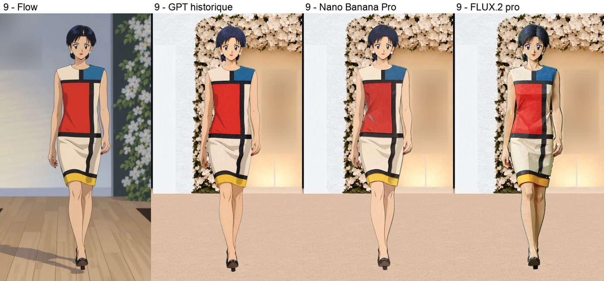
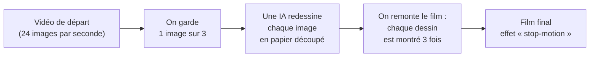
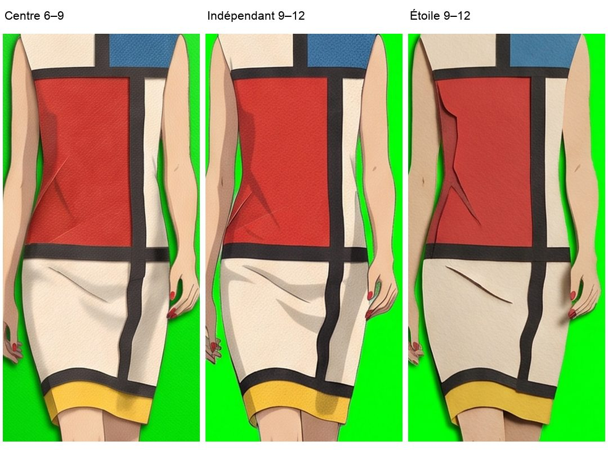
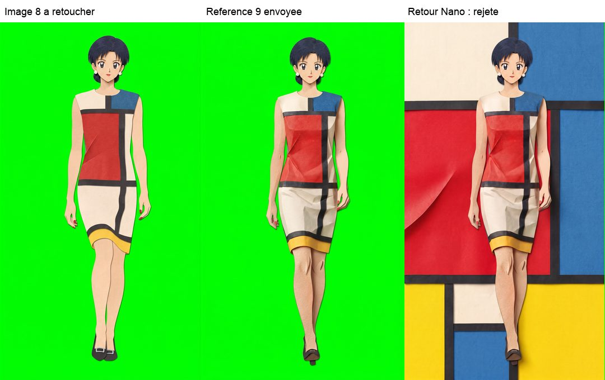

# Peut-on animer un personnage en « papier découpé » avec une IA d'images ?

Journal d'une expérience menée en octobre 2026 : transformer une courte vidéo d'animation en un film image par image façon **kirigami** (sculpture de papier découpé), en faisant redessiner chaque image par une intelligence artificielle.

*De gauche à droite : la vidéo source, GPT Image 2, Nano Banana Pro et FLUX.2 [pro]. Même pose, trois façons d'interpréter le papier. Les monogrammes du décor ont été floutés.*

**En une phrase :** l'IA dessine de très belles images une par une, mais elle ne garde pas exactement le même papier, les mêmes plis et le même visage d'une image à l'autre. Dans une animation, ces petites différences se voient comme un tremblement. Ce dépôt raconte tout ce qui a été essayé pour corriger ce problème, ce qui a marché, ce qui a échoué, et pourquoi.

> **À qui s'adresse ce document ?** À toute personne curieuse, sans connaissances techniques préalables : lycéens, stagiaires, étudiants. Chaque mot technique est expliqué la première fois qu'il apparaît, et un [glossaire](docs/glossaire.md) les rassemble tous.

## Le projet en un schéma

## Par où commencer ?

| Si tu veux… | Lis |
|---|---|
| Comprendre le but du projet et le vocabulaire de base | [1. Le projet](docs/01-le-projet.md) |
| Comprendre le problème principal, avec des exemples | [2. Le problème : le style qui change](docs/02-le-probleme.md) |
| Suivre les 14 essais, un par un, avec leurs résultats | [3. Journal des essais](docs/03-journal-des-essais.md) |
| Connaître les leçons à retenir et les pistes restantes | [4. Ce que nous avons appris](docs/04-ce-que-nous-avons-appris.md) |
| Voir comment deux IA et un humain ont travaillé ensemble | [5. Méthode de travail](docs/05-methode-de-travail.md) |
| Comprendre le rôle de ComfyUI, ses nœuds et son utilisation dans Desktop | [6. ComfyUI, l’atelier technique](docs/06-comfyui.md) |
| Chercher un mot | [Glossaire](docs/glossaire.md) |
| Lire le code | [Le code](code/README.md) |

## ComfyUI, l’atelier technique

**ComfyUI occupe une place importante dans la chaîne de travail.** Ses graphes de nœuds ont servi à appeler GPT Image, Nano Banana Pro et FLUX.2, puis à préparer un guide de chaussure et à réinsérer des retouches sous masque. Les scripts Python assurent le pilotage, les journaux et les contrôles.

Le rôle de ComfyUI a évolué : les derniers essais de génération passaient directement par Google, tandis que les blocs locaux de préparation et de correction restaient disponibles. La [page dédiée](docs/06-comfyui.md) détaille les recettes, les circuits payants et locaux, les limites et leur ouverture dans Comfy Desktop.

## Les résultats en bref

| Famille d'essais | Nombre d'essais | Résultat |
|---|---:|---|
| Mieux guider l'IA d'images (choix du modèle, consignes, images de référence, conversation…) | 8 | Améliorations ponctuelles, mais le style change toujours d'un appel à l'autre. |
| Retoucher localement sur l'ordinateur, sans IA (déformer un papier approuvé, recalculer les ombres) | 2 | Le papier retouché devient stable, mais seule une partie du personnage est traitée : le reste change encore. |
| **Problème principal** | | **Non résolu à la fin de l'expérience.** Trois pistes restent à essayer (voir [chapitre 4](docs/04-ce-que-nous-avons-appris.md)). |

### Le problème, vu de près

*La même pose 9 dans le centre de référence, un appel indépendant, puis une conversation en étoile. Le grain et les plis changent malgré la pose commune. [Lire les essais 12 à 14](docs/03-journal-des-essais.md#essai-12--quatre-poses-sur-une-seule-feuille).*

Un échec documenté est aussi un résultat : savoir dans quelles conditions une recette échoue évite de la répéter à l'identique et aide à choisir la suite. Cela ne prouve pas qu'une famille entière de méthodes est impossible.

## Un piège à repérer : la référence qui impose sa pose

*À gauche, la pose demandée ; au centre, l'image de référence pour la matière ; à droite, le résultat rejeté. Le modèle a repris la pose de la référence et ajouté un décor. [Voir l'essai 5](docs/03-journal-des-essais.md#essai-5--montrer-limage-9-entière-comme-modèle).*

## Qui a fait quoi ?

- **L'auteur du projet** a fixé le but artistique, choisi les pistes, autorisé les dépenses par essai ou par série et jugé les images.
- **Codex** (un assistant de programmation d'OpenAI) a écrit les programmes, lancé les essais et rédigé les comptes rendus.
- **Claude** (un assistant d'Anthropic) a relu les analyses, vérifié les sources et les chiffres, proposé des pistes et rédigé cette documentation.

Les deux assistants se sont relus mutuellement, et se sont corrigés plusieurs fois. Ces corrections sont racontées honnêtement dans le [chapitre 5](docs/05-methode-de-travail.md).

## Images et droits

- Projet personnel à but d'apprentissage, sans affiliation commerciale.
- Le personnage et les références de mode ne sont pas nommés dans cette version.
- Les images sont des adaptations graphiques utilisées pour documenter les essais. Le retrait des noms et le floutage des signes distinctifs ne règlent pas, à eux seuls, la question des droits des tiers.
- Les monogrammes visibles dans le comparatif des modèles ont été floutés. Les personnages, leurs robes et les autres pixels de cette illustration sont conservés.
- Les vidéos et la plupart des images produites ne sont pas publiées ici.

## Coût de l'expérience

Les journaux disponibles comptent **94 requêtes d'API réussies pour 97 images reçues**, dont quatre propositions d'ancre. Une planche de quatre poses compte comme une seule image reçue du service ; ses quatre cases ne sont pas quatre appels. Les copies de journaux et les récupérations d'une réponse déjà reçue ne sont pas comptées deux fois.

En appliquant les provisions du projet — environ 0,08 $ par image GPT, 0,1608 $ par image Nano et jusqu'à 0,18 $ par image FLUX — la reconstitution donne **environ 12 $ pour les images reçues**. Ce n'est pas un tarif universel ni un montant débité : certains anciens journaux n'inscrivaient pas encore la provision, reprise ici des configurations et comptes rendus.

Deux demandes ont une issue et un débit inconnus ; un refus pour solde insuffisant est aussi consigné. Une retouche par l'outil d'image intégré n'expose pas son coût et reste hors de ce calcul. Le total réellement payé n'est donc pas établi. Les retouches déterministes locales n'ont ajouté **aucun appel d'API** ; les images qui leur servent de base avaient déjà été générées.
