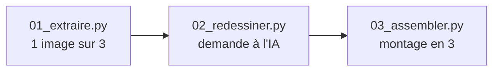

# Le code du projet

[← Accueil](../README.md)

Ce dossier contient une sélection des programmes écrits pendant l'expérience, en **Python**, publiée pour la lecture et l'étude. Ce n'est pas une reproduction autonome de tous les essais : vidéo, références, dessins intermédiaires et plusieurs préparateurs/compositeurs propres aux séances ne sont pas inclus. Les réglages qui renvoient à ces données ne sont pas exécutables tels quels.

## Organisation

```
code/
├── config.json      réglages principaux (modèle, cadence, durée du test…)
├── configs/         réglages de chaque essai (un fichier par essai)
├── prompts/         consignes envoyées aux IA
├── scripts/         les programmes
├── tests/           les tests automatiques
└── workflows/       recettes ComfyUI (au format JSON) et leur documentation
```

Un **fichier JSON** est un fichier texte qui range des informations sous forme de paires « nom : valeur ». C'est un format très courant pour les réglages.

## Les étapes principales



| Script | Rôle | Essai(s) |
|---|---|---|
| `01_extraire.py` | Extrait une image sur trois de la vidéo. | 1 |
| `02_redessiner.py` | Envoie chaque image à une IA (par ComfyUI, OpenAI ou Google) et range le résultat. Annonce le coût estimé, tient le journal, bloque les soumissions non résolues. | Générations des essais 1–6, 8–9 et 12–14 |
| `gemini_direct.py` | Appel direct au service de Google, avec conservation de la réponse complète et, en option, de la conversation (« historique »). | 9, 13, 14 |
| `03_assembler.py` | Monte les séries disposant de dessins : chaque dessin tenu 3 images à 24 i/s. Les bruts rejetés ne sont pas tous montés ; les alternances de diagnostic ont leurs propres recettes locales. | Séries montées, notamment 1, 2, 4–6 et 10–12 |
| `12_essai_propagation_matiere.py` | Déforme le papier de l'image 9 vers d'autres poses grâce à un maillage. | 10 |
| `13_comparer_ab_plis.py` | Prépare la comparaison des consignes A et B. | 8 |
| `14_relief_doux_local.py`, `15_verifier_doux_mouvement.py` | Recette « Doux » : ombres reprises de la vidéo, couleur fixée, grain accroché aux panneaux. | 11 |
| `16_essai_planche_2x2.py` | Prépare les planches de quatre poses et les découpe en quatre cases ; la découpe sert aussi à l'essai étoile. | 12–14 |
| `04_pilote.py`, `05_preparer_pilote.py`, `atelier.py` | Préparation du pilote, annotations, masques, propagation et mesures locales. Ce n'est pas le programme de mesure de Claude de l'essai 7. | Pilote d'amélioration, essais 8–11 |
| `06_comparer_reprise.py` | Compare Flow, la base, l'ancienne finition Comfy et la reprise Google de la pose 10. | 9 |
| `07_` à `11_` | Corrections de détails, par exemple la boucle des chaussures, et finalisation des dessins témoins avec la tête protégée. | 9 |
| `commun.py`, `normalisation.py`, `correctif_detail.py` | Fonctions partagées : lecture des réglages, mise au même format des images, etc. | Tous |

## Les tests automatiques

Un **test automatique** est un petit programme qui vérifie qu'un autre programme fait bien ce qu'il doit faire. Par exemple : « si une demande reste sans réponse, le programme ne doit pas la renvoyer ».

Prérequis pour les tests : **Python 3**, **NumPy**, **Pillow**, **ffmpeg** et **ffprobe**, disponibles dans l'environnement choisi. Aucun SDK fournisseur ni modèle d'IA n'est requis par ces tests. Depuis le dossier `code/` :

```sh
python3 -m unittest discover -s tests
```

Dans cette copie publique revue, **36 tests sur 36 passent** avec ces prérequis. Le test de montage fabrique une petite vidéo de couleur unie dans un dossier temporaire : il vérifie la configuration, la priorité de `--grain 0`, les 48 frames, les 24 i/s et les deux secondes sans dépendre de la vidéo privée. Aucun test n'envoie de vraie demande payante : les échanges avec les services d'IA sont simulés.

## Les clés d'accès

Pour utiliser un service d'IA payant, il faut une **clé d'API**, une sorte de mot de passe personnel. Les programmes lisent ces clés dans des **variables d'environnement** (`COMFY_API_KEY`, `OPENAI_API_KEY`, `GEMINI_API_KEY`), c'est-à-dire des réglages de l'ordinateur. **Aucune clé n'est écrite dans les fichiers du projet**, et il ne faut jamais en écrire une dans un fichier publié.

## Remarques

- Les commentaires et les noms de variables sont en français.
- Certains chemins ont été anonymisés en `~/`, et des scripts d'aperçu utilisent des polices macOS. Un `Path` Python ne développe pas automatiquement `~` : ces chemins et les ressources absentes sont à adapter avant toute relance. Aucun appel payant n'est nécessaire pour lire le code ou exécuter la suite de tests.
- Le programme de mesure de continuité de l'essai 7 n'est pas inclus : sa première version contenait l'erreur de masque décrite dans le journal.

## Adaptation de cette version publique

Les noms de maisons de couture, de personnage et de référence artistique ont été remplacés par des descriptions génériques, jusque dans les chemins, prompts et workflows. Ces formulations anonymisées ne sont donc pas une copie mot pour mot des consignes historiques ; les résultats illustrés restent ceux des essais d’origine.
