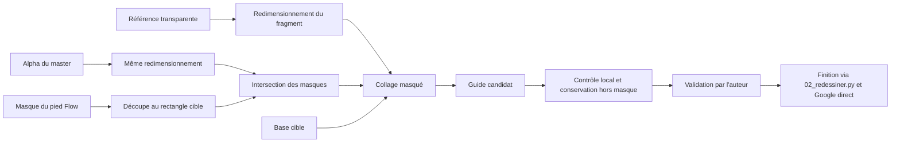

# Chaussure de référence dans ComfyUI

Le workflow `guide_chaussure_master_local.json` est importable dans l'interface ComfyUI. Il emploie seulement des nœuds natifs : aucun custom node, installation, modèle local ou appel API payant. La recette API est `guide_chaussure_master_local_api.json`; son gabarit demande de sélectionner les fichiers dans les trois LoadImage. L'exécution exacte et ses noms de fichiers se trouvent dans `travail/guide_chaussure_10_integration/workflow_execute.json`.

## Ce que fait le groupe de nœuds



Le master contient un alpha déjà détouré dans geometrique. `LoadImage` renvoie un masque de transparence inversé : `InvertMask` rétablit son alpha utile. Le même redimensionnement est appliqué au RGB et à l'alpha. Le collage est limité par la silhouette Flow **et par un polygone manuel de la chaussure visible**, pour ne pas recouvrir la jambe.

Pour la pose 10, le fragment retenu est le dessus avec la boucle. Le talon et la semelle du master correspondent à une autre orientation et sont écartés; les zones non couvertes gardent les pixels de la base. Le pied arrière reste inchangé. Ce n'est pas une reconstruction 3D et le master ne fournit pas les vues absentes.

Le mode `--semelle` remplace le masque utile par zéro : aucune boucle n'est collée sous un pied. Un calage propre à chaque autre pose doit être fourni avec `--calage`. Ne pas recopier les coordonnées de 10 à toute la séquence.

## Premier essai

Master : `~/oct/geometrique/essai_kirigami/preparation/chaussure_nette_pour_guides.png`.

Calage manuel : `refs/chaussures_geometrique/calage_pose10.json`. Les coordonnées sont dans le cadre 720 × 1280. Le script ajuste le cadre entier de la base sans recadrer le personnage. Le masque Flow est celui déjà préparé dans le projet; son contour reste approximatif.

```sh
PY_IMAGES=~/.cache/codex-runtimes/codex-primary-runtime/dependencies/python/bin/python3
"$PY_IMAGES" scripts/07_guide_chaussure_comfy.py --fragment-dessus --essai mon_calage --executer-local
```

Choisir un nouveau nom d'essai : les essais précédents sont conservés. Le script exporte la recette graphique, la recette réellement exécutée, les entrées, le guide et le masque. L'empreinte du master original et les paramètres sont conservés dans `protocole.json`.

### Conservation des pixels

Lors du premier contrôle, 49 pixels hors masque présentaient un écart d'un niveau dans l'export ComfyUI. Le script garde `guide_brut_comfy.png`, refuse tout écart extérieur supérieur à un niveau et rétablit les pixels originaux hors masque dans `guide.png`. C'est ce fichier contrôlé qui devient la cible de finition. Une réexécution manuelle de la seule recette graphique produit le brut : passer par le script pour obtenir la conservation exacte vérifiée. Aucun modèle ni prompt de finition n'est modifié pour résoudre ces arrondis.

## Finition après validation du guide

Le script prépare un plan isolé `pilote_chaussure_master_10`, sans remplacer les témoins précédents. La configuration `configs/pilote_chaussure_master.json` garde l'accès **Google direct** et la recette de matière actuelle :

```sh
python3 scripts/02_redessiner.py --plan pilote_chaussure_master_10 --config configs/pilote_chaussure_master.json --simulation
# Après validation du guide et annonce du coût seulement :
python3 scripts/02_redessiner.py --plan pilote_chaussure_master_10 --config configs/pilote_chaussure_master.json --oui
```

L'estimation de la finition est 0,16 USD pour une image. Aucun appel de finition n'est lancé par le prétraitement. Si l'on choisit `--backend comfy` avec cette configuration, le workflow partenaire historique Nano sera utilisé et consommera des **crédits Comfy**, pas le compte Google direct. Ce choix n'a pas été exécuté.

Pour intégrer le guide à une recette de finition dans l'interface ComfyUI, relier la sortie `IMAGE` de « Guide chaussure » à la place de la première source du `ImageBatch`, puis conserver l'ancre en deuxième image. Cette connexion est indépendante du bloc local; elle ne dispense pas du contrôle du guide ni du choix explicite de la facturation du fournisseur.

## État de validation

Exécution locale réelle réussie sur 10; aucune génération payante. Tests : liste blanche de nœuds, masque nul en mode semelle, restauration des arrondis, rejet d'une vraie modification hors masque. Avec les tests existants : 19 tests réussis. L'essai graphique a été exécuté par l'API locale; l'import visuel du fichier UI n'a pas été testé dans le navigateur.

Le guide est un candidat à examiner dans `sortie/guide_chaussure_master_comparatif.png`. La pose, l'aspect papier de la pièce collée et la conservation de la boucle après finition ne sont pas déclarés validés. La finition peut encore modifier la chaussure; son résultat devra être contrôlé. Aucun gain temporel mesuré ni extension à la série n'est revendiqué.
