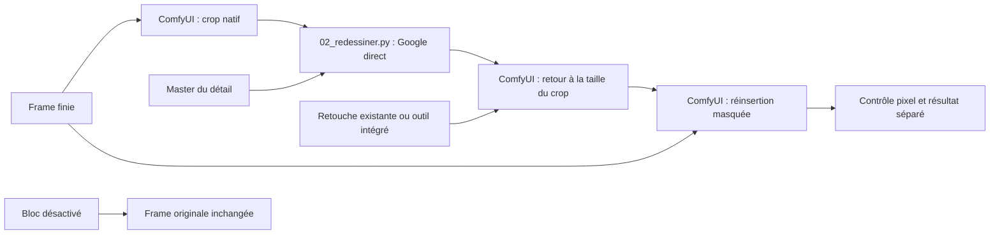

# Bloc correctif facultatif — gros plan, retouche, réinsertion

Implémentation à la demande de l'auteur. Ce bloc intervient seulement sur une frame et un détail explicitement sélectionnés, après la finition générale. Il ne modifie pas la recette principale ni les bruts.

## Architecture et facturation



Deux groupes sont importables dans l'interface ComfyUI :

- `correctif_detail_preparation.json` : charge la frame, découpe le gros plan, exporte la cible.
- `correctif_detail_reinsertion.json` : charge frame/retouche/masque, redimensionne le crop et insère le détail à ses coordonnées d'origine.

Ces fichiers utilisent uniquement des nœuds natifs et les entrées locales du test déjà téléversées. Aucun nœud payant, aucune clé ni installation supplémentaire dans ces groupes. Les recettes API réellement exécutées sont conservées dans chaque essai de travail.

**L'enchaînement complet est piloté par `scripts/10_correctif_detail.py`**, pas par un unique bouton de génération dans ComfyUI. La phase Google reste extérieure au graphe Comfy et passe par `02_redessiner.py` pour conserver les journaux, l'annonce de coût et la protection contre les soumissions en double. Dans l'interface seule, on prépare le crop puis on charge la retouche reçue dans le groupe de réinsertion. L'outil d'image intégré ne devient pas un nœud Comfy : son résultat peut être chargé comme retouche existante.

## Configuration

`configs/correctif_boucle_pose10.json` fixe la source, sa taille native attendue, le master, le crop en `[x,y,largeur,hauteur]`, le rectangle local à retoucher, le raccord doux et la ligne de protection de la semelle. `actif: false` désactive tout le bloc, sans réseau ni génération.

Ce premier calage est celui de la boucle de la **pose 10**, en 1536 × 2752, avec un crop 320 × 400. Il ne faut pas le recopier aveuglément aux autres poses. Pour un autre détail ou une autre pose, créer une configuration distincte et vérifier visuellement le crop, le masque et les références. Le filtrage du vert et la protection de la semelle sont spécifiques à ce cas chaussure; ce n'est pas un masque anatomique universel.

Le prompt dédié est `prompts/correctif_boucle_master.txt`. Il demande une petite boucle rectangulaire argentée ajourée, avec centre noir, sans bride ajoutée, en conservant la pose du pied et sa matière papier.

## Commandes

Utiliser le runtime d'images existant :

```sh
PY_IMAGES=~/.cache/codex-runtimes/codex-primary-runtime/dependencies/python/bin/python3
```

Préparation seule, gratuite, avec un nom d'essai neuf :

```sh
"$PY_IMAGES" scripts/10_correctif_detail.py preparer --essai boucle10_preparation
```

Préparation et réinsertion d'une retouche existante, sans génération :

```sh
"$PY_IMAGES" scripts/10_correctif_detail.py appliquer --essai boucle10_reinsertion \
  --retouche travail/pilote_chaussure_master_10/imagegen/retouche_pieds_integree_brute.png
```

Enchaînement avec une nouvelle retouche Google :

```sh
"$PY_IMAGES" scripts/10_correctif_detail.py generer --essai boucle10_google
```

Cette dernière commande prépare le crop, puis `02_redessiner.py` annonce **1 image, environ 0,16 USD**, et demande confirmation. Ajouter `--oui` seulement après autorisation de cette série. Après réception, le script réinsère le résultat et vérifie les pixels : cela ne vaut pas validation artistique. Le modèle/API peut donner un résultat différent de celui de l'outil intégré, malgré une consigne similaire.

Le backend Google est fixé au modèle `gemini-3-pro-image` en 2K, format 4:5 pour ce crop. Les clés restent dans l'environnement; elles ne transitent pas par les graphes Comfy. Le budget est une provision; le débit réel est celui de Google, et les compteurs de tokens se trouvent dans le journal de génération.

## Reprise et fichiers conservés

Chaque essai est sous `travail/correctif_<nom>/`. Le script refuse de réutiliser un dossier existant pour éviter d'écraser un résultat ou de soumettre une génération par erreur.

On y trouve les bruts, le crop exact, le crop brut Comfy, le masque, le master, le prompt, la configuration Google effective, les workflows API, les identifiants locaux, le protocole et le journal. `frame_corrigee.png` est le candidat final; `reinsertion_brute_comfy.png` conserve l'export de Comfy avant contrôle.

Si une génération échoue ou est interrompue : ne pas relancer `generer` sous un autre nom pour contourner le journal. Consulter le `journal.jsonl` de l'essai et utiliser `02_redessiner.py --reprendre <identifiant>` avec son fichier `generation.json` si une réponse est récupérable. Après récupération, utiliser `appliquer --essai <nouveau_nom> --retouche travail/correctif_<ancien_nom>/out/r0010.png`, qui ne soumet aucun nouvel appel payant. L'index interne 0010 identifie ce pilote de détail; le nom de la source véritable figure dans le protocole.

## Contrôles et limites

Le masque est fixe pour toutes les variantes comparées; il est limité au détail, exclut le fond vert et ne touche pas le bas protégé de l'image. Le rendu est inséré au même endroit, sans recalage du personnage. Après export, les éventuels arrondis d'un niveau hors masque sont rétablis depuis la source. Un écart supérieur est refusé. Le brut original est vérifié par empreinte.

Test réel effectué : `appliquer --essai bloc_boucle10_test`, avec le crop déjà retouché par l'outil intégré. Les deux tâches Comfy ont réussi. Zéro différence hors masque, source et semelle conservées; zéro nouvel appel payant. Résultat : `travail/correctif_bloc_boucle10_test/frame_corrigee.png`. Les 25 tests automatisés passent, dont désactivation sans réseau, refus de nœuds payants dans le client local, mauvais calage, exclusion du vert, protection de la semelle et contrôle des pixels extérieurs.

Le parcours de génération directe est câblé et utilise le backend Gemini déjà testé, mais **aucune nouvelle génération Google de ce crop n'a été effectuée pour valider ce bloc**. L'import graphique a été exporté; l'exécution des graphes est validée par l'API locale, pas par un test d'import dans le navigateur. Le résultat reste à examiner visuellement; la stabilité sur plusieurs poses n'est pas démontrée.
