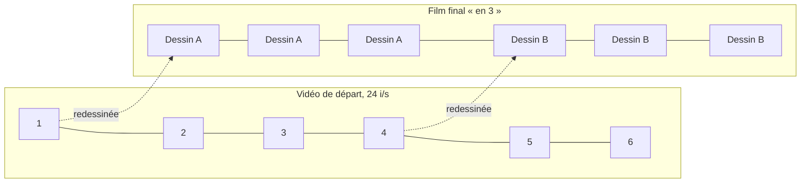
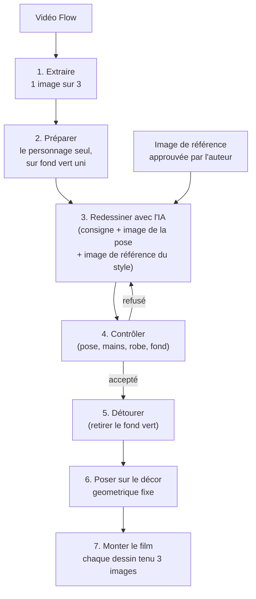

# 1. Le projet

[← Accueil](../README.md) · [Chapitre suivant →](02-le-probleme.md)

## Le but artistique

Au départ, il y a une courte vidéo d'animation : un personnage de dessin animé marche comme sur un défilé de mode, vêtue d'une robe à grands panneaux de couleur (rouge, bleu, jaune, ivoire) séparés par des bandes noires, à composition géométrique. Cette vidéo a été fabriquée avec **Flow**, un outil de Google qui génère des vidéos par intelligence artificielle.

Le but : obtenir **le même mouvement**, mais dessiné comme une **sculpture de papier découpé**, avec du vrai grain de papier, des bords épais, des plis en relief et une élégance de haute couture. C'est ce que le projet appelle le style « kirigami couture ». Le *kirigami* est l'art japonais de découper et plier le papier.

Le résultat doit ressembler à un film en **stop-motion** : une technique où l'on photographie des objets réels en les déplaçant un tout petit peu entre chaque photo.

## Trois notions pour comprendre la suite

### Une vidéo, c'est une suite d'images

Une vidéo n'est qu'une série d'images fixes montrées très vite. Chaque image s'appelle une **frame** (prononcer « frème »). La vidéo de départ affiche **24 images par seconde** (on note « 24 i/s »). Deux secondes de film, c'est donc 48 images.

### Animer « en 3 »

Redessiner 48 images pour deux secondes coûterait cher, et le résultat serait trop fluide pour un effet stop-motion. Les animateurs utilisent une astuce ancienne : **chaque dessin est montré pendant 3 images de suite**. On ne dessine qu'une image sur trois.

Pour deux secondes : 48 images, mais seulement **16 dessins**. C'est le « test de 2 secondes » dont il sera souvent question. Le plan complet compte 66 dessins.

### Redessiner avec une IA, c'est « appeler » un service payant

Les dessins ne sont pas faits à la main : ils sont demandés à une **IA générative d'images**, c'est-à-dire un programme entraîné sur d'immenses quantités d'images, capable d'en créer de nouvelles à partir d'une description en texte et d'images d'exemple.

Ces IA tournent sur les ordinateurs de grandes entreprises. Pour les utiliser, un programme leur envoie une demande par Internet et reçoit un dessin en retour. On appelle ça un **appel d'API** (une *API* est une porte d'entrée prévue pour que des programmes discutent entre eux). Chaque appel coûte quelques centimes.

Une demande contient :
- **la consigne** (en anglais *prompt*) : un texte qui décrit ce qu'on veut ;
- **des images de référence** : par exemple l'image de la vidéo à redessiner (pour la pose) et un dessin déjà approuvé (pour le style).

Trois IA ont été utilisées au cours du projet :

| Nom | Entreprise | Rôle dans le projet |
|---|---|---|
| GPT Image 2 | OpenAI | Premiers essais |
| FLUX.2 [pro] | Black Forest Labs | Comparé une fois, non retenu |
| Nano Banana Pro (nom technique : `gemini-3-pro-image`) | Google | IA principale à partir du 29 octobre |

## La chaîne de fabrication

Voici comment un dessin est fabriqué, de la vidéo au film :

Pourquoi un **fond vert** ? C'est la technique de l'incrustation, utilisée au cinéma et à la météo à la télévision : on dessine le personnage sur un vert très vif, puis un programme retire tout ce qui est de cette couleur. On peut ensuite poser le personnage sur n'importe quel décor.

## Les outils autour de l'IA

- **ComfyUI** : un logiciel qui permet d'enchaîner des opérations sur des images sous forme de « boîtes » reliées par des fils. Il a servi au début pour envoyer les demandes aux IA.
- **Python** : le langage de programmation des scripts du projet (voir [le code](../code/README.md)).
- **ffmpeg** : un outil gratuit pour découper et monter des vidéos.
- **Git** : un outil qui garde l'historique de toutes les versions des fichiers d'un projet. Ce dépôt en est un.

[Chapitre suivant : le problème →](02-le-probleme.md)
