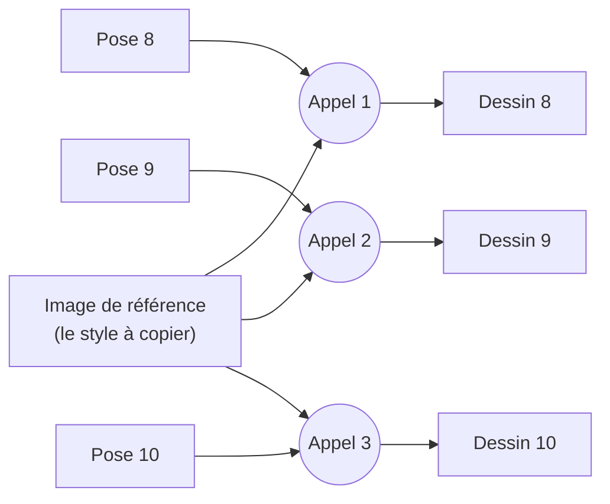

# 2. Le problème : le style qui change d'une image à l'autre

[← Chapitre précédent](01-le-projet.md) · [Accueil](../README.md) · [Chapitre suivant →](03-journal-des-essais.md)

## Un exemple concret

Voici **la même pose** (la pose numéro 9), dessinée lors de trois appels à la même IA. Les deux premiers appels sont indépendants, avec la même ancre et des consignes analogues pour deux groupes de poses. Le troisième reprend le premier échange dans une conversation, puis ajoute une nouvelle grille et une consigne courte : ce ne sont donc pas trois demandes identiques.

*De gauche à droite : centre 6–9, appel indépendant 9–12, puis branche conversationnelle 9–12. La pose 9 est la même, mais le relief du papier, les plis, les ombres et le visage changent.*

Chaque image, prise seule, est réussie. Le problème apparaît quand on les met bout à bout : dans le film, 8 dessins défilent chaque seconde. Si le papier, les plis ou le visage changent légèrement à chaque dessin, l'œil voit un **tremblement**, comme si le personnage était fait d'une matière qui bouillonne. Pour un film en papier découpé, c'est raté : un vrai personnage en papier garde la même feuille d'une photo à l'autre.

## Ce qui change, concrètement

| Élément | Exemple observé dans le projet |
|---|---|
| **Le relief du papier** | Sur un dessin, le papier semble épais et sculpté ; sur le suivant, plat et graphique. |
| **Les plis de la robe** | Un pli doux devient une arête anguleuse, ou une « languette » apparaît là où il n'y en avait pas. |
| **Le grain** | La texture fine du papier change d'aspect et d'échelle. |
| **La lumière** | Une robe devient légèrement brillante alors que le papier doit rester mat. |
| **Le visage et la coiffure** | Les yeux, les sourcils ou les mèches changent ; une petite fente claire apparaît dans les cheveux. |
| **Le fond** | Le fond vert uni demandé reçoit des ombres ou des motifs inventés. |
| **Les détails du costume** | La boucle d'une chaussure devient dorée, ou disparaît. |

## Pourquoi ça arrive : le dessinateur sans mémoire

Une image vaut mieux qu'un long discours. Imagine un dessinateur très doué, mais **sans aucune mémoire** :

- Chaque fois que tu l'appelles, il a tout oublié de la fois précédente.
- Tu lui montres un modèle (« dessine dans ce style ») et la pose voulue.
- Il fait de son mieux… mais il redessine **tout** depuis zéro : le papier, les plis, la lumière, le visage.

*Chaque appel est indépendant : aucune information ne passe d'un dessin au suivant. La référence est la même, mais l'IA l'interprète à nouveau chaque fois.*

Plusieurs facteurs peuvent contribuer à ce comportement ; les essais ne permettent pas d'attribuer une part précise à chacun :

1. **Le hasard fait partie de la méthode.** Une IA générative tire au sort une partie de ses choix à chaque création. Deux demandes identiques donnent donc deux images différentes. Certains outils permettent de fixer ce tirage (on parle de **graine**, en anglais *seed*), mais les services utilisés ici ne garantissent pas qu'une même graine redonne la même image.
2. **Une image de référence est une inspiration, pas un calque.** L'IA en retient une impression générale (couleurs, matière, ambiance). Elle ne recopie pas pixel par pixel, sauf parfois… quand on ne le voudrait pas (voir l'[essai 5](03-journal-des-essais.md#essai-5--montrer-limage-9-entière-comme-modèle)).
3. **La vidéo donne des indications de plis, sans définir une surface en 3D.** Sur les deux images Flow examinées (frames source 15 et 24), environ 10 % du grand panneau rouge se trouvent dans une teinte d'ombre. Ce comptage utilise un seuil de luminosité `V < 190` à l'intérieur d'un masque rouge érodé de 9 pixels, au format 720 × 1280 : il ne mesure pas des plis en trois dimensions. Les marques changent avec la pose ; l'IA doit les traduire en volume de papier et peut aussi ajouter des arêtes absentes de la source. Le relief ne part donc pas de zéro, mais sa traduction reste variable.

## Pourquoi c'est difficile à corriger

On pourrait croire qu'il suffit d'écrire « garde exactement le même papier » dans la consigne. Le projet a essayé : ça ne suffit pas. Une consigne est une demande, pas une garantie. Toute la suite du projet a consisté à chercher **ce qui peut réellement forcer la stabilité** :

- donner à l'IA plus d'informations (meilleures références, conversation, plusieurs poses à la fois) ;
- ou retirer à l'IA une partie du travail, en le faisant faire par un programme classique, qui lui ne connaît pas le hasard.

Le [journal des essais](03-journal-des-essais.md) raconte chaque tentative.

[Chapitre suivant : le journal des essais →](03-journal-des-essais.md)
