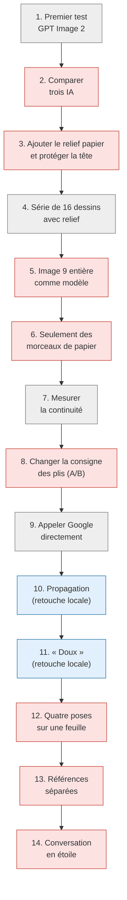
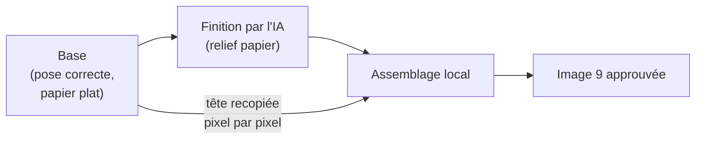
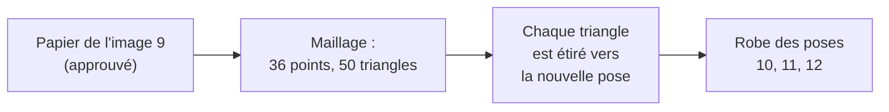
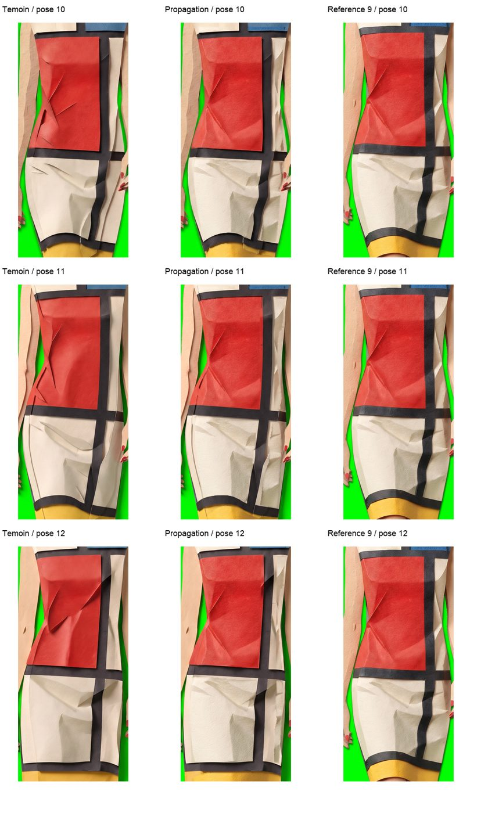
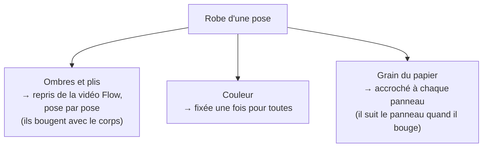
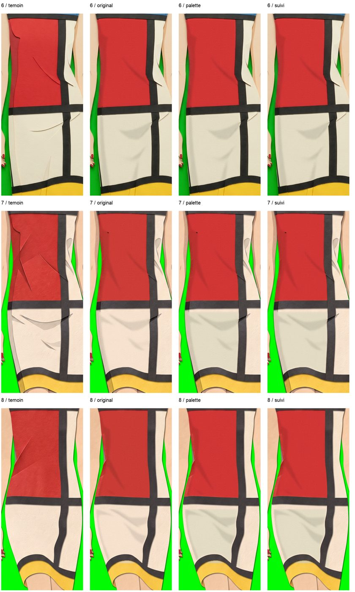
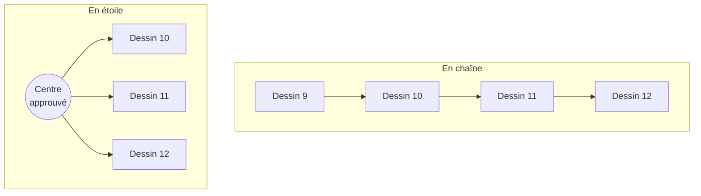

# 3. Journal des essais

[← Chapitre précédent](02-le-probleme.md) · [Accueil](../README.md) · [Chapitre suivant →](04-ce-que-nous-avons-appris.md)

Ce chapitre regroupe 14 étapes du projet, les 28–30 octobre 2026, dans un ordre pédagogique. Ce n'est pas une chronologie stricte : l'accès direct Google et la propagation ont notamment précédé le filtre A/B final. Chaque essai suit le même plan :

- **L'idée** : ce qu'on espérait ;
- **Ce qui a été fait** ;
- **Résultat** : ce qu'on a observé ;
- **Pourquoi** : l'explication la plus probable de la réussite ou de l'échec ;
- **Coût** : nombre de dessins payants et estimation.

Les coûts sont des **provisions**, pas des montants réellement débités. Les réglages historiques étaient d'environ 0,08 $ par image GPT, 0,1608 $ par image Nano et jusqu'à 0,18 $ par image FLUX. Les images déjà disponibles sont réutilisées entre essais : additionner les bases décrites dans chaque section les compterait parfois deux fois.

## Vue d'ensemble

*En rouge : essais qui cherchent à mieux guider l'IA. En bleu : retouches locales, sans IA. En gris : production, mesure ou changement d'outil.*

---

## Essai 1 — Le premier test avec GPT Image 2

**L'idée.** Construire toute la chaîne de fabrication (voir [chapitre 1](01-le-projet.md#la-chaîne-de-fabrication)) et produire un premier test de 2 secondes : 16 dessins.

**Ce qui a été fait.** Chaque image retenue de la vidéo a été envoyée à GPT Image 2 avec une image de référence fixe, appelée l'**ancre** (comme l'ancre d'un bateau, elle doit empêcher le style de dériver). Un choix important a été fait dès le départ : chaque dessin part de l'ancre, **jamais du dessin précédent**, pour éviter que les erreurs s'additionnent comme au jeu du téléphone.

**Résultat.** Le film existe, mais il saccade. Les pieds et la tête ne tombent pas toujours au bon endroit : le bas des chaussures était décalé en moyenne de 22 pixels (sur une image de 1280 pixels de haut), jusqu'à 51 pixels. Après 18 nouvelles demandes et une sélection à la main, l'écart moyen est descendu à 13 pixels.

**Pourquoi.** L'IA redessine la silhouette à sa façon et ne la pose pas exactement sur celle de la vidéo. Pour aider, des **repères** (petits traits blancs dans les marges, à la hauteur du crâne et des pieds) ont été ajoutés aux images envoyées. Ça a amélioré la position, sans la rendre parfaite.

**Coût.** Le journal cumulé compte **40 redessins réussis**, plus **4 propositions d'ancre**. Les 18 reprises décrites ci-dessus sont la dernière poursuite, pas toutes les reprises du projet. Avec la provision historique de 0,08 $ par image, cela représente environ 3,52 $ pour ces 44 images ; le débit réel n'est pas fourni.

---

## Essai 2 — Comparer trois IA

**L'idée.** Et si une autre IA tenait mieux le style ?

**Ce qui a été fait.** Les mêmes trois poses (9, 10 et 11) ont été données à Nano Banana Pro (Google) et à FLUX.2 [pro] (Black Forest Labs), avec exactement les mêmes images et la même consigne. Les anciens résultats de GPT Image 2 servaient de point de comparaison.

*De gauche à droite : l'image de la vidéo Flow, GPT Image 2, Nano Banana Pro, FLUX.2 [pro].*

**Résultat.**

| IA | Position des pieds (écart, en pixels) | Haut des cheveux (écart) | Observation |
|---|---|---|---|
| GPT Image 2 | +11 / +16 / +7 | +1 / 0 / −4 | Pieds trop bas |
| **Nano Banana Pro** | **+1 / +1 / +2** | −4 / −5 / −6 | Coiffure et visage stables, fond vert propre, mais ajoute des plis |
| FLUX.2 [pro] | −2 / +4 / −1 | −4 / −16 / −20 | Cheveux qui changent d'une image à l'autre, fond vert abîmé |

**Nano Banana Pro est retenu.**

**Pourquoi.** Nano suit mieux la pose et garde mieux l'identité du personnage. Attention : trois dessins, c'est très peu pour conclure. Et la comparaison avec GPT n'est pas parfaitement équitable, car ses images n'avaient pas été préparées exactement de la même façon.

**Coût.** 6 dessins, environ 0,70 à 1 $.

---

## Essai 3 — Ajouter le relief papier, et protéger la tête

**L'idée.** Les dessins de Nano étaient assez plats. On ajoute une **deuxième passe** : l'IA reprend son propre dessin (la **base**) et lui donne un vrai relief de papier (la **finition**).

**Ce qui a été fait.** Sur la pose 9, la finition a reçu la base et quelques **échantillons de matière** (petits morceaux de papier découpés dans un autre dessin). Problème : la finition redessinait aussi le visage. Solution : un petit programme recopie **pixel par pixel** la tête de la base sur la finition. L'IA garde le corps, la tête reste intacte.

**Résultat.** Une image 9 très réussie, **approuvée par l'auteur**. Elle deviendra la référence de matière pour la suite.

**Pourquoi.** Séparer le travail en deux passes permet de contrôler chaque étape. Et une retouche faite par un programme classique (la copie de la tête) est **exacte et répétable**, contrairement à une demande faite à l'IA.

**Coût.** 2 dessins (Nano et GPT, pour comparer), environ 0,24 $.

---

## Essai 4 — Une série visée de 16 dessins avec relief, restée partielle

**L'idée.** Appliquer la recette de l'essai 3 aux 16 dessins du test.

**Ce qui a été fait.** 16 bases disponibles : trois historiques et treize nouvelles. Quatre bases ont été reprises. Huit nouvelles finitions ont réussi ; la finition 9 déjà approuvée a été réutilisée. Neuf compositions avec tête protégée ont donc été préparées, pas seize finitions achevées.

**Résultat.** Le relief est **inégal** : les dessins 7 à 9 sont beaucoup plus sculptés que les précédents. En plus, la demande pour le dessin 10 est restée bloquée plus de 15 minutes chez le fournisseur ; le programme s'est arrêté comme prévu, sans renvoyer la demande (ce qui aurait pu la faire payer deux fois).

**Pourquoi.** C'est la première apparition nette du problème principal : chaque finition invente son propre relief. La protection de la tête marche, mais elle ne protège… que la tête.

**Coût.** **25 nouvelles images réussies** : 13 bases + 4 reprises + 8 finitions, soit environ 4,02 $ de provision. La demande bloquée de la finition 10 s'ajoute avec une issue et un débit inconnus.

---

## Essai 5 — Montrer l'image 9 entière comme modèle

**L'idée.** Puisque l'image 9 plaît, la donner comme modèle de matière pour redessiner les poses 6, 7 et 8.

**Résultat.** Rejet pour la pose 8 : l'IA a **recopié la pose de l'image 9** et inventé un fond geometrique autour.

*À gauche, le dessin à retoucher ; au centre, l'image 9 envoyée comme modèle ; à droite, le résultat rejeté.*

**Interprétation.** Une image de référence contient la matière, mais aussi la pose, le cadrage et le décor. Dans ce résultat, la référence semble avoir imposé plus que le papier demandé. C'est un risque de mélange entre style et composition ; cette observation ne permet pas de dire comment l'IA a traité chaque instruction.

**Coût.** 3 dessins, environ 0,48 $.

---

## Essai 6 — Montrer seulement des morceaux de papier

**L'idée.** Corriger l'essai 5 : au lieu de l'image entière, envoyer une planche de **4 extraits** de l'image 9 (grain du rouge, courbure du papier, relief ivoire, jonction des bandes noires), sans visage, sans mains, sans silhouette.

**Résultat.** Mieux : la pose 8 ne recopie plus la pose 9, et les défauts de l'essai 5 disparaissent. Mais les plis varient encore d'un dessin à l'autre.

**Interprétation.** Retirer la silhouette complète réduit ici la concurrence entre les deux poses. Cela ne garantit pas qu'aucun élément des échantillons ne sera recopié : l'essai 13 montrera un autre échec de ce type. Les plis restent réinterprétés.

**Coût.** 3 dessins, environ 0,48 $.

---

## Essai 7 — Mesurer la continuité (et se tromper)

**L'idée.** Juger « à l'œil » ne suffit pas. On veut **un chiffre** qui dise si deux dessins consécutifs se ressemblent.

**Ce qui a été fait.** Claude a écrit un programme gratuit qui :
1. calcule le mouvement entre deux dessins grâce au **flux optique** (une technique qui retrouve, pour chaque point d'une image, où il est passé dans l'image suivante) ;
2. « déplace » le premier dessin pour le superposer au second ;
3. mesure ce qui reste différent, une fois le mouvement retiré : c'est le **résidu**.

Plus le résidu est petit, plus les deux dessins sont cohérents.

**Résultat, puis correction.** Le premier calcul annonçait que la recette de l'essai 6 était « 5 à 17 % meilleure ». En relisant, Codex a montré que c'était faux : dans certains dessins, la zone mesurée comprenait de grands morceaux de fond (des échantillons de papier que l'IA avait recopiés autour du personnage). On comparait donc des surfaces différentes. Codex a aussi montré que l'affirmation « la vidéo Flow n'a aucun pli » était fausse : elle en a peu, mais elle en a.

**Pourquoi c'est important.** Un chiffre faux est plus dangereux qu'une absence de chiffre, parce qu'on lui fait confiance. Leçons tirées :
- vérifier **ce que l'on mesure** (ici, le masque qui délimite le personnage) avant de publier un pourcentage ;
- comparer des **zones identiques** dans toutes les versions ;
- le flux optique est fragile dans les grands aplats. Sur les sept premières paires mesurées, 37 à 63 % du panneau rouge passaient le contrôle aller-retour à moins de 3 pixels. C'est une cohérence numérique, pas une preuve que ces correspondances sont toutes justes ; la paire suivante atteignait 84 %.

**Coût.** 0 dessin.

---

## Essai 8 — Changer la consigne des plis (test A/B)

**L'idée.** Peut-être que l'IA ajoute trop de plis parce que la consigne de base le lui demande (« conserve les plis de l'image »). On écrit une nouvelle consigne, **B**, qui demande de transformer les ombres de la vidéo en courbures douces, sans arêtes ni languettes.

**Ce qui a été fait.** Un **test A/B** sur la pose 6, avec mêmes entrées, référence, modèle et qualité ; seul le paragraphe de plis change entre A et B, mais les tirages fournisseur ne sont pas contrôlés. Deux dessins A et trois dessins B ont été reçus, tous conservés. Une première demande B est restée sans réponse et un des dessins B a été rejeté. Les deux reprises ont été autorisées séparément.

**Résultat.** Pas de progrès répété avec B. Les deux dessins A diffèrent aussi visiblement entre eux. Aucune mesure ne permet d'affirmer que leur écart est exactement aussi grand que l'écart entre A et B.

**Pourquoi.** Quand le hasard produit des écarts aussi grands que l'effet qu'on cherche, un ou deux essais ne permettent pas de conclure. Il faudrait beaucoup plus de dessins… et donc beaucoup plus de dépenses.

**Coût.** 6 demandes (dont une restée sans réponse), environ 0,96 $.

---

## Essai 9 — Appeler Google directement

**L'idée.** Jusque-là, les demandes passaient par ComfyUI. Le projet passe à un appel **direct** au service de Google, avec une clé personnelle. Avantages : plus de contrôle, et la possibilité d'essayer des fonctions avancées (voir l'essai 14).

Ce changement concerne le circuit de génération : ComfyUI sert aussi aux guides de chaussure et aux corrections locales. Le [chapitre 6](06-comfyui.md) détaille ces usages et leur articulation avec Google direct.

**Ce qui a été fait.** Un nouveau petit programme envoie la demande, puis enregistre **la réponse complète** de Google sur le disque. Ainsi, si quelque chose se passe mal après coup, on peut relire la réponse sans repayer un dessin.

**Résultat.** Ça marche. Google renvoie un **JPEG**, qui peut perdre du détail à la compression, et non un **PNG**, qui n'ajoute pas de perte. Aucun réglage de sortie PNG pris en charge n'avait été identifié pour l'API Developer de ce circuit. La conversion locale en PNG ne restaure pas les détails déjà perdus. Une contribution de cette compression à la variation perçue reste possible, mais n'a pas été mesurée ici.

**Coût.** 1 dessin pour le premier essai réel.

---

## Essai 10 — La propagation : déformer un papier approuvé

**L'idée.** Arrêter de demander à l'IA de réinventer le papier à chaque fois. On prend le papier de l'image 9 approuvée et on le **déforme** pour qu'il épouse la robe des poses 10, 11 et 12, comme on étire une décalcomanie. C'est une retouche locale, faite par un programme classique : **pas d'IA, pas de hasard, gratuit**.

**Ce qui a été fait.** On place 36 points de correspondance sur la robe (coins des panneaux, jonctions des bandes noires), reliés en 50 triangles : c'est un **maillage**. Chaque triangle de l'image 9 est étiré pour recouvrir le triangle correspondant de la nouvelle pose. Quatre versions ont été nécessaires avant d'obtenir un résultat propre sur les bords.

*Pour chaque pose (10, 11, 12) : le dessin de l'IA, la version propagée, et la référence 9.*

**Résultat.** Le grain et les ombres deviennent bien plus réguliers entre les trois poses. Mais :
- les **plis de l'image 9 sont transportés avec le papier**, et ne correspondent pas toujours à la nouvelle pose (c'est très visible sur la pose 12) ;
- seulement **31 à 32 % environ du personnage** se trouvent dans les masques de transfert : union des masques positifs des panneaux, divisée par une silhouette de détourage approximative (`alpha > 127`), à 720 × 1280. C'est une mesure ajoutée lors de la revue, pas un score de stabilité. Le visage, les bras, les jambes et les zones non couvertes restent ceux des témoins Nano ;
- à la frontière entre le papier transporté et les zones gardées, un **trait sombre** apparaît parfois.

**Interprétation.** Transporter l'image du papier transporte ses ombres et ses plis, parfois inadaptés à la nouvelle pose. Les raccords avec les zones gardées peuvent créer une couture visible. De plus, le maillage utilisé pour mesurer la continuité était celui qui produisait la propagation : la baisse du résidu est favorisée par construction et ne constitue pas une validation indépendante.

**Coût.** Aucun nouvel appel d'API pour la propagation. Les témoins et leurs membres finis avaient déjà nécessité des générations et des corrections ; cette voie hybride ne rend pas toute la production gratuite.

---

## Essai 11 — « Doux » : garder le papier, recalculer les ombres

**L'idée.** Combiner le meilleur des deux mondes en séparant trois choses :

Ce qui doit bouger (les plis) bouge, ce qui doit rester (le papier et sa couleur) reste.

**Ce qui a été fait.** Un programme local applique cette recette au panneau rouge et au grand panneau ivoire, sur les poses 6, 7 et 8.

*Pour chaque pose : le dessin de l'IA (témoin), puis trois variantes de la retouche « Doux ».*

**Résultat.** Moins d'arêtes inventées et des indications de plis reprises de la vidéo. La recette initiale changeait de palette et gardait un grain fixe à l'écran ; la variante « suivi » corrige ces deux points sur les panneaux traités. Le reste conserve les variations des témoins. Une mesure après coup trouve **17 à 25 % de pixels modifiés** dans la silhouette : au moins une composante RGB diffère de plus de 3 niveaux entre variante « suivi » et témoin normalisés. Ce seuil n'est ni la surface exacte des masques, ni une mesure de stabilité. Le rendu peut aussi paraître plus peint que sculpté.

**Limites.** Les deux panneaux traités restent une candidate partielle : pointe sombre en pose 7, raccords hors masque, texture répétitive et suivi 2D approximatif. Étendre la retouche pourrait créer de nouveaux raccords à contrôler ; cela n'a pas été testé sur tout le corps.

**Coût.** 0 $.

---

## Essai 12 — Quatre poses sur une seule feuille

**L'idée.** Demander **quatre poses sur la même image** (une planche de 2 × 2 cases) pourrait favoriser un papier et une lumière communs. C'est une hypothèse, pas une garantie.

**Ce qui a été fait.** Deux planches : poses 6 à 9, puis poses 9 à 12. La pose 9 figure **sur les deux planches** : c'est le **témoin de contrôle**. Si le style est verrouillé, les deux versions de la pose 9 doivent se ressembler.

**Résultat.** Sur une même planche, les quatre dessins se ressemblent bien. Mais **d'une planche à l'autre, le relief change** : la pose 9 est très sculptée sur la première planche, plate sur la seconde.

**Interprétation et limite.** Les cases paraissent proches au sein de chaque planche, mais le relief change entre les deux appels. Deux planches ne démontrent ni une stabilité garantie à l'intérieur d'un appel, ni la cause du changement entre appels. Le groupe des trois autres poses et le tirage changent ensemble.

**Coût.** 2 appels (8 dessins), environ 0,32 $.

---

## Essai 13 — Des références séparées pour chaque rôle

**L'idée.** Donner trois images avec un rôle bien précis : les poses (les silhouettes de la vidéo), l'identité (le visage et la coiffure seuls) et la matière (des échantillons de papier).

**Résultat.** Le fond des quatre cases est rempli de grands panneaux rouges, bleus et ivoire, ressemblant aux échantillons. La robe paraît plus lisse et un peu brillante. Le premier brut échouant à la contrainte de fond, la seconde planche n'a pas été soumise : la stabilité entre deux appels n'a pas été testée avec cette recette.

**Pourquoi.** Les échantillons ressemblent eux-mêmes à des panneaux geometrique, donc au contenu de l'image. L'IA ne fait pas la différence entre « voici un exemple de matière » et « voici quelque chose à dessiner ». Attention : trois choses avaient changé en même temps (la planche de matière, le visage séparé et la consigne). On ne sait donc pas laquelle a causé l'échec.

**Coût.** 1 appel, environ 0,16 $.

---

## Essai 14 — La conversation « en étoile »

**L'idée.** Le service de Google permet d'envoyer une **conversation** : on rejoue l'échange précédent (la demande et le dessin obtenu), avec les **notes de travail** de l'IA (une donnée chiffrée appelée *signature*), puis on ajoute une nouvelle demande. L'espoir : que l'IA « se souvienne » de la façon dont elle a dessiné.

Pour éviter l'effet « téléphone », chaque nouvelle demande repart **du même dessin approuvé**, placé au centre : c'est l'organisation en étoile.

**Ce qui a été fait.** Le centre retenu pour l'essai est la planche 6–9 de l'essai 12 ; ce choix ne valide pas ses défauts pour la production. Un seul appel envoie trois messages : texte et images du premier tour reconstitués et vérifiés par empreintes contre le journal d'origine ; contenu modèle complet avec son JPEG original et sa signature intacts ; nouvelle grille 9–12 et consigne courte. La requête réellement envoyée a été comparée octet par octet à sa préparation, pas à un ancien corps HTTP qui n'avait pas été sauvegardé.

**Résultat.** Le protocole technique a fonctionné. Les quatre poses restent globalement proches de Flow, sans copie manifeste du centre ; leur anatomie fine n'est pas entièrement validée. Mais **la matière du centre n'est pas conservée sur cet essai** : sur la pose 9, le papier devient plus mat et plus plat, les plis deviennent des arêtes sombres, et le visage et la coiffure changent. L'appel **sans conversation** de l'essai 12 était même plus proche du centre pour le visage.

**Limites.** La transmission du contexte est prouvée ; la façon dont le modèle l'a utilisé ne l'est pas. Un seul centre et une seule branche ne suffisent ni à établir une amélioration statistique, ni à exclure toutes les conversations en étoile. Consigne courte, historique et contexte des poses ne sont pas isolés causalement.

**Coût.** 1 appel, environ 0,14 à 0,16 $.

---

## Tableau récapitulatif

| Essai | Famille | Ce qu'il visait | Résultat |
|---|---|---|---|
| 1. GPT Image 2 | Production | Chaîne complète | Saccades, pieds mal placés |
| 2. Trois IA | Guider l'IA | Choisir le meilleur modèle | Nano retenu |
| 3. Relief + tête protégée | Guider l'IA | Relief papier | Image 9 approuvée |
| 4. Série de 16 | Production | Appliquer la recette | Relief inégal |
| 5. Image 9 entière | Guider l'IA | Imposer la matière | Pose recopiée |
| 6. Morceaux de papier | Guider l'IA | Imposer la matière sans la pose | Mieux, plis variables |
| 7. Mesure | Mesure | Chiffrer la continuité | Erreur de mesure corrigée |
| 8. Consigne A/B | Guider l'IA | Moins de plis inventés | Pas de progrès répété |
| 9. Google direct | Outil | Plus de contrôle | Fonctionne, sortie en JPEG |
| 10. Propagation | Retouche locale | Papier stable | Stable mais rigide, couture |
| 11. Doux | Retouche locale | Papier stable, plis mobiles | Bon sur la robe, reste instable |
| 12. Planche 2 × 2 | Guider l'IA | Même style pour 4 poses | Apparence proche au sein des deux planches testées, relief différent entre elles |
| 13. Références séparées | Guider l'IA | Rôles clairs | Échantillons recopiés en décor |
| 14. Étoile | Guider l'IA | Mémoire entre appels | Matière et visage changent |

[Chapitre suivant : ce que nous avons appris →](04-ce-que-nous-avons-appris.md)
