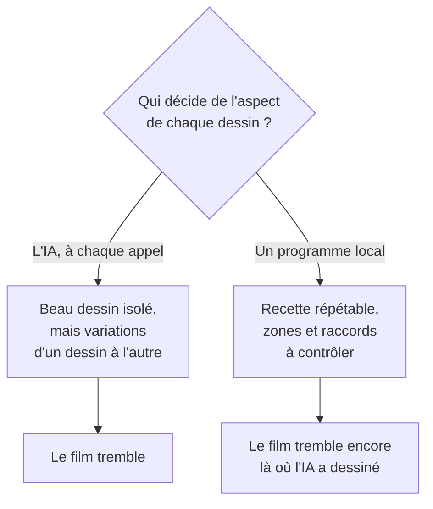
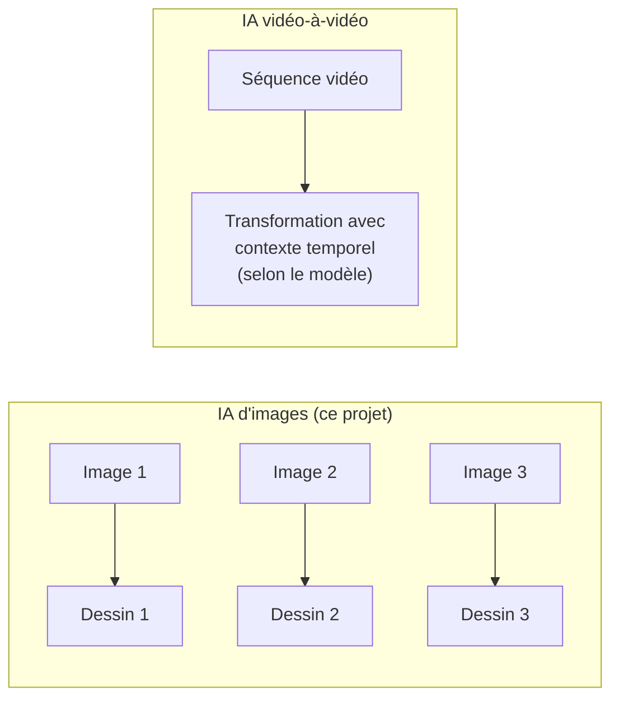

# 4. Ce que nous avons appris

[← Chapitre précédent](03-journal-des-essais.md) · [Accueil](../README.md) · [Chapitre suivant →](05-methode-de-travail.md)

## Le constat principal

Les essais de consigne, références, planches et conversation n'ont pas obtenu la même matière sur toute la séquence. **Les recettes testées n'ont pas verrouillé le rendu.** Cela ne prouve pas qu'aucune IA d'images ou autre préparation ne pourrait réussir.

Les retouches locales sont répétables à entrées et paramètres fixés. Elles peuvent stabiliser certains aspects des zones traitées, tout en déformant le grain ou en créant des raccords. Les variations conservées des témoins restent visibles ailleurs.

## Dix leçons à retenir

1. **Une consigne n'est pas une garantie.** Écrire « garde le même papier » ne suffit pas : l'IA l'interprète à chaque fois.
2. **Une image de référence transmet tout ce qu'elle contient.** Montrer un dessin entier pour sa matière, c'est aussi montrer sa pose et son décor (essai 5). Montrer des échantillons qui ressemblent à du contenu, c'est risquer qu'ils soient recopiés (essai 13).
3. **Tester une seule variable à la fois.** Quand trois choses changent ensemble, on ne sait pas laquelle a produit l'effet (essais 6 et 13).
4. **Le hasard peut cacher l'effet qu'on cherche.** Si deux dessins faits avec la même recette diffèrent autant que deux recettes différentes, un ou deux essais ne prouvent rien (essai 8).
5. **Prévoir un témoin de contrôle.** Dessiner la même pose dans deux appels a permis de voir le problème sans ambiguïté (essais 12 et 14).
6. **Vérifier ce que l'on mesure.** Un pourcentage calculé sur une mauvaise zone était faux, et il a fallu une relecture pour le voir (essai 7).
7. **Ce qui est fait par un programme classique est exact et répétable.** La tête recopiée pixel par pixel (essai 3) ne varie jamais. Mais chaque frontière entre deux origines peut créer une couture visible (essai 10).
8. **Ne jamais renvoyer une demande automatiquement.** Une demande restée sans réponse a peut-être été facturée. Le programme du projet s'arrête et attend une décision humaine (essais 4 et 8).
9. **Conserver toutes les réponses brutes.** Elles ont permis de relire, de convertir et de rejouer des dessins sans repayer (essais 9 et 14).
10. **Un échec bien documenté fait gagner du temps.** Il évite de répéter une recette inchangée. Il ne condamne pas toutes les variantes de cette piste.

## Ce qui reste à essayer

À la fin de l'expérience, trois pistes n'avaient pas encore été testées.

### Piste A — Un modèle d'image plus récent

Le catalogue OpenAI référence **GPT Image 2.5 Sunburst** et **Flare**, annoncés le 8 septembre 2026. Sunburst est présenté pour les tâches où la précision d'édition compte le plus. Ces modèles n'ont pas été testés dans cette expérience. Sources vérifiées le 30 octobre 2026 : [fiche Sunburst](https://developers.openai.com/api/docs/models/gpt-image-2.5-sunburst) et [journal des nouveautés OpenAI](https://developers.openai.com/api/docs/changelog).

*Mais :* une promesse de précision d'édition ne démontre pas la conservation du grain et des plis entre poses différentes. Les sources citées ne fournissent pas de mesure du cas précis de ce projet. Un essai devrait comparer une même pose dans plusieurs appels et contrôler aussi des poses différentes, sans supposer un meilleur résultat.

### Piste B — Un modèle vidéo plutôt qu'un modèle d'image

Les IA **vidéo-à-vidéo** peuvent utiliser plusieurs images et un contexte temporel pour transformer une séquence. Cela peut favoriser la continuité, sans garantir le maintien du mouvement, du costume ou du papier. Leur traitement n'englobe pas nécessairement toute la vidéo en une seule fois : certains outils travaillent par fenêtres. Si un résultat convenable est obtenu, on peut ensuite ne garder qu'une image sur trois et tenir chaque dessin trois frames pour retrouver la cadence « en 3 ».

*À vérifier avant un essai :* prise en charge d'une image de style, fidélité aux poses et aux détails, durée, résolution, coût et accès au service choisi. Deux secondes réduisent le volume du test, sans lever automatiquement ces limites.

### Piste C — La marionnette de papier

C'est l'idée de l'essai 10, étendue à tout le personnage : découper un dessin approuvé en pièces (tête, buste, bras, jambes, panneaux de robe), puis les déplacer et les déformer pour suivre Flow. Réemployer les mêmes pièces réduit la réinvention du style, sans garantir un grain non étiré, des plis crédibles ou de bons raccords. Les zones nouvellement révélées demanderaient aussi une préparation. L'étape locale n'ajouterait pas d'appel d'API si les pièces nécessaires existent déjà.

*Risque :* un mouvement plus raide, « de marionnette », surtout quand les jambes se croisent et que la robe se plie. C'est aussi un travail plus long à mettre en place.

### Et une question de goût

En animation dessinée à la main, un trait qui « bouillonne » légèrement est parfois un choix artistique assumé. Accepter une petite vibration, et ne corriger que les variations trop fortes (visage, relief), est aussi une réponse possible. C'est à l'auteur d'en décider.

## Résumé des pistes

| Piste | S'attaque à la cause ? | Coût d'un essai | Principal risque |
|---|---|---|---|
| A. GPT Image 2.5 Sunburst | Non, chaque image reste dessinée séparément | Quelques appels | Même problème qu'avec Nano |
| B. Vidéo-à-vidéo | Utilise un contexte temporel, résultat à tester | Selon le service retenu | Dérive de style, de mouvement ou de détails |
| C. Marionnette de papier | Réemploie les mêmes pièces, avec raccords à vérifier | Pas de nouvel appel si les pièces existent | Rigidité, étirement et occultations |

[Chapitre suivant : la méthode de travail →](05-methode-de-travail.md)
