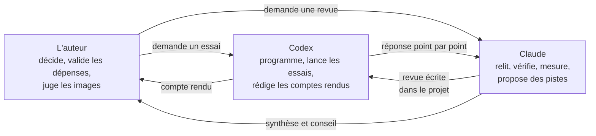

# 5. Méthode de travail : deux IA et un humain

[← Chapitre précédent](04-ce-que-nous-avons-appris.md) · [Accueil](../README.md) · [ComfyUI →](06-comfyui.md)

Ce projet a été mené par l'auteur avec deux assistants d'IA aux rôles différents. Cette organisation est intéressante en elle-même, parce que les deux assistants se sont **trompés plusieurs fois**, et que la plupart des erreurs ont été rattrapées grâce aux relectures croisées.

## Qui fait quoi

Une **revue**, c'est une relecture critique : on vérifie les faits, les sources et les chiffres, et on signale ce qui semble faux, fragile ou oublié. Chaque revue était déposée dans le projet sous forme de fichier, et l'autre assistant devait répondre à chaque point par « d'accord », « en désaccord » ou « à nuancer », **avec une preuve** : un fichier, une ligne de code, une mesure ou une image.

## Les règles du projet

Ces règles étaient écrites dans un fichier lu par les assistants au début de chaque séance :

1. **Aucune dépense hors de l'autorisation donnée.** L'accord peut porter sur une série, avec des limites et points d'arrêt. Avant les appels payants, le nombre d'images et la provision sont annoncés.
2. **Aucune installation sans accord.** Le projet devait fonctionner sans installer de modèle d'IA sur l'ordinateur.
3. **Pas de nouvelle tentative automatique.** Si une demande reste sans réponse, on ne la renvoie pas : elle a peut-être déjà été facturée.
4. **Tout conserver.** Les dessins bruts, même ratés, les réponses complètes des fournisseurs et un **journal** de chaque action restent sur le disque.
5. **Distinguer « l'appel a réussi » et « le dessin est bon ».** Un service qui renvoie une image sans erreur ne dit rien de sa qualité artistique.
6. **Ne pas cacher un défaut.** Si un dessin a une mauvaise pose, on le rejette ; on ne le recouvre pas avec une retouche pour le faire passer.
7. **Distinguer l'estimation du coût réel.** Le coût affiché par le programme est une provision ; le montant débité se lit chez le fournisseur.
8. **Séparer l'observation de l'avis.** Un compte rendu dit d'abord ce qu'on voit, puis ce qu'on en pense.

## Les erreurs rattrapées

Voici des exemples réels de corrections. Ils montrent qu'une affirmation sûre d'elle peut être fausse, et que la relecture est utile.

| Ce qui avait été affirmé | Par qui | Qui a corrigé | La correction |
|---|---|---|---|
| « La vidéo Flow n'a aucun pli dans le panneau rouge. » | Claude | Codex | Elle a une ou deux ombres de plis par panneau (environ 10 % de la surface). La statistique utilisée cachait ces ombres. |
| « Cette recette est 5 à 17 % plus stable. » | Claude | Codex | La zone mesurée contenait du fond dans certains dessins. Le chiffre n'était pas valable. |
| « Un lissage est incompatible avec l'animation en 3. » | Claude | Codex | On peut lisser les 16 dessins avant de les tenir 3 images. C'était trop catégorique. |
| « La conversation avec l'IA est impossible dans ce projet. » | Claude | L'auteur | Le projet appelait déjà Google directement, ce qui la rend possible. Claude se basait sur une ancienne version. |
| « Le centre de l'étoile doit être un nouveau dessin. » | Claude | Codex | Un dessin déjà obtenu par appel direct convenait, s'il était approuvé. |
| « L'utilisateur du ticket cité ne parle pas d'images toutes les 5 frames. » | Claude | Codex | Si : c'était dans un commentaire, avec la commande utilisée. |
| La propagation devait garder les bras et jambes de la base, non finie. | Plan de Codex | Claude | Cela aurait mélangé une robe finie et des membres non finis. Le plan a été corrigé. |
| Une piste de recherche (TokenFlow) était gardée « à examiner ». | Codex | Claude, puis Codex | Elle requiert un accès aux mécanismes internes d'un modèle de diffusion, hors du circuit API retenu. Elle reste une référence scientifique, pas une voie d'implémentation immédiate. |
| Le test A/B prévoyait un seul dessin par variante. | Plan de Codex | Claude | Avec autant de hasard, un dessin ne prouve rien : deux dessins par variante ont été faits. |
| La preuve de désactivation du grain citait les configurations d'essai. | Codex | Claude | L'ancien assembleur ne les lisait pas : c'était l'option `--grain 0` qui désactivait le grain. Un choix explicite de configuration a ensuite été ajouté. |

## Conseils pour reproduire cette méthode

- **Écrire les règles avant de commencer**, et les relire à chaque séance.
- **Faire relire par quelqu'un d'autre**, humain ou IA, surtout les chiffres.
- **Demander des preuves** plutôt que des affirmations : « montre-moi le fichier, la ligne, la mesure ».
- **Garder un journal daté** de chaque essai : ce qu'on a fait, ce qu'on a vu, ce que ça a coûté.
- **Accepter de s'être trompé** et le noter : une correction écrite évite qu'une autre personne refasse la même erreur.

[Chapitre suivant : ComfyUI, l’atelier technique →](06-comfyui.md) · [Glossaire](glossaire.md)
