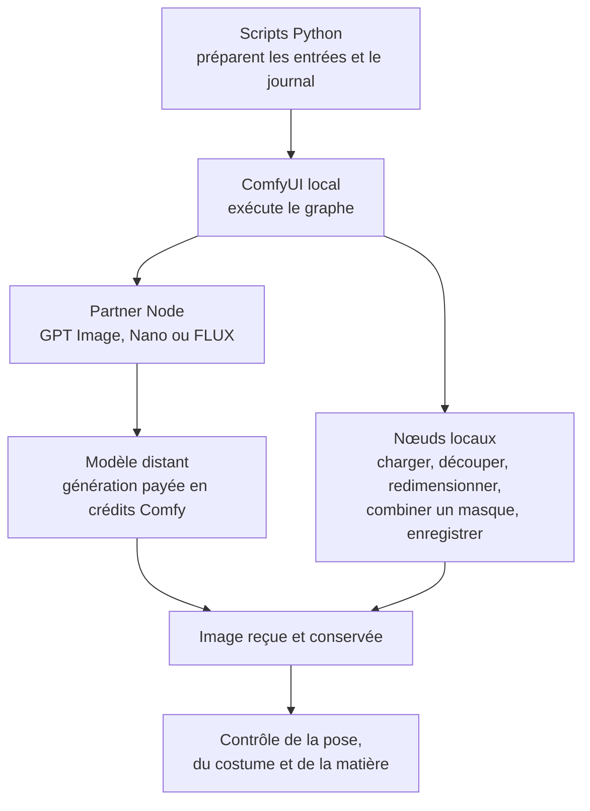
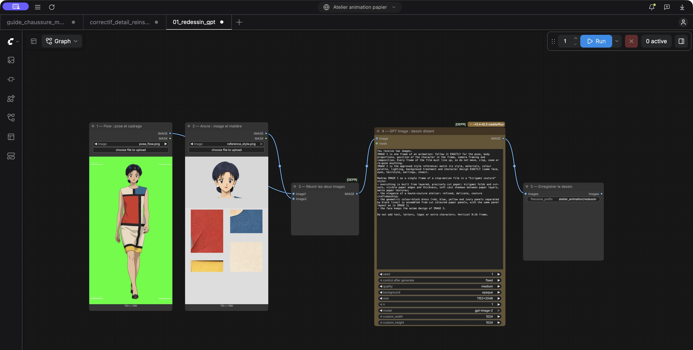
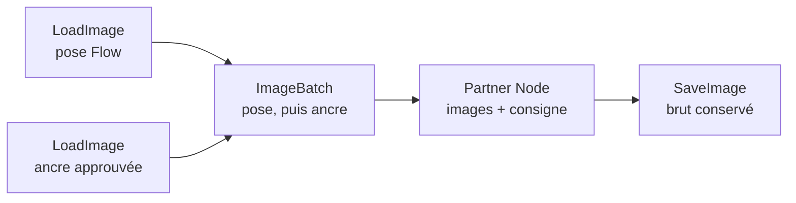
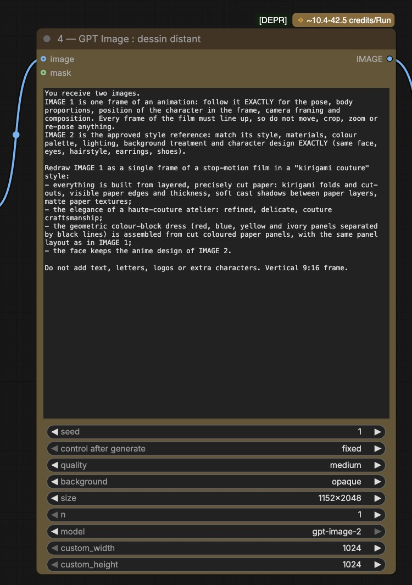
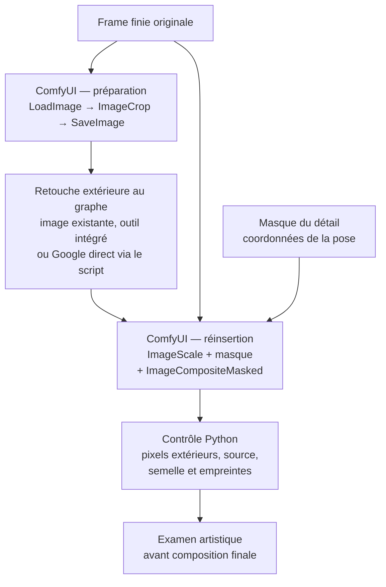
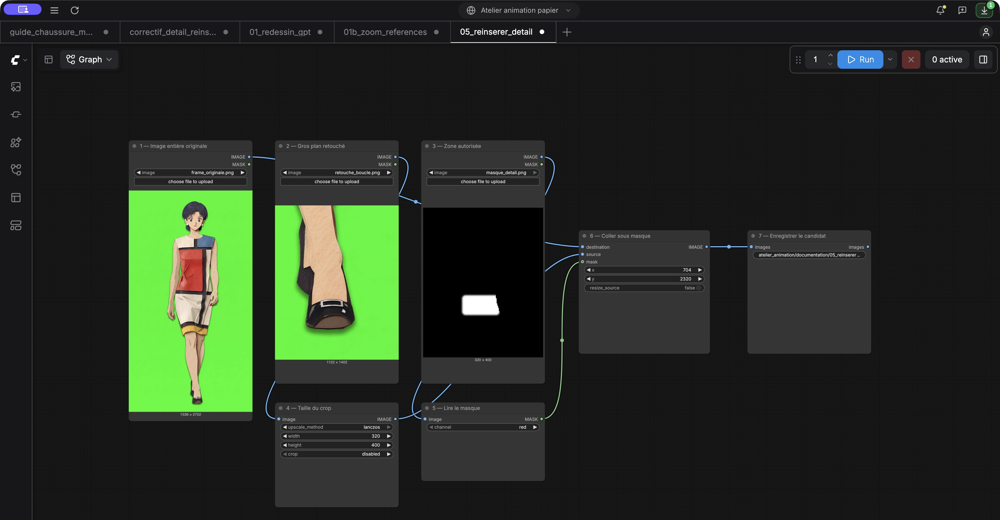
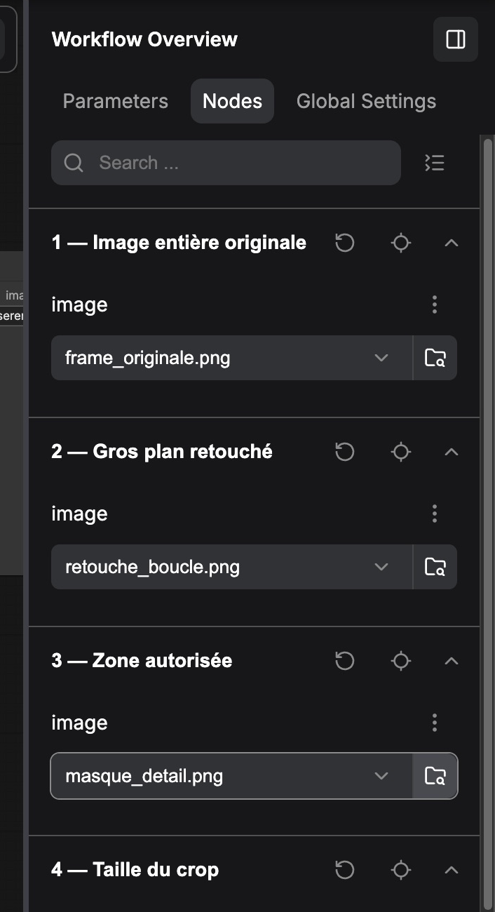

# 6. ComfyUI : l’atelier technique du projet

[← Chapitre précédent](05-methode-de-travail.md) · [Accueil](../README.md) · [Glossaire →](glossaire.md)

**ComfyUI a permis de construire et de faire évoluer la chaîne de traitement des images.** Son rôle a changé au cours du projet : d’abord appeler les modèles d’IA, puis préparer des guides et réinsérer des corrections locales. Ces blocs restent dans l’architecture au dernier état documenté. Les derniers essais de génération, eux, utilisaient directement le service de Google.

Cette page suit cette évolution jusqu’à l’essai de conversation en étoile. Elle distingue ce qui a réellement été exécuté, ce qui est disponible dans les fichiers et ce qui resterait à intégrer. Le problème de cohérence du style reste ouvert ; le plan complet de 66 dessins n’est pas un résultat validé de cette expérience.

## Comprendre les boîtes et les fils

Un **nœud** est une boîte qui effectue une opération : charger une image, la redimensionner, découper un gros plan ou demander un dessin à une IA. Les fils transportent les images et les masques entre les boîtes. L’ensemble forme un **workflow**, une recette de traitement que l’on peut enregistrer et rouvrir.

Dans ce projet, ComfyUI fonctionne sur l’ordinateur. Certains nœuds traitent les pixels sur place ; les **Partner Nodes** envoient une demande à un modèle hébergé chez un fournisseur. Aucun poids de GPT Image, Nano Banana Pro ou FLUX.2 n’a été installé sur le Mac. Cette distinction entre traitement local et modèles distants est celle de la [documentation officielle des Partner Nodes](https://docs.comfy.org/tutorials/partner-nodes/overview).

Ouvrir un graphe ne lance pas de génération. Dans notre circuit, les nœuds locaux n’ajoutent aucun appel payant ; les Partner Nodes consomment des crédits lorsqu’ils exécutent une demande. Les règles générales de facturation sont expliquées par [Comfy](https://support.comfy.org/articles/5846341390-how-credits-work-in-comfy).

## Son rôle, du premier essai au dernier

| Étape | Utilisation de ComfyUI dans le projet | Ce qu’il faut retenir |
|---|---|---|
| Ancre et premiers dessins GPT Image | Charger la pose, ajouter la référence, appeler GPT Image et enregistrer les images. | Le script répète la même structure pour chaque dessin du test. |
| Comparaison des trois modèles | Remplacer le nœud de génération par Nano Banana Pro ou FLUX.2 [pro], avec des recettes distinctes. | ComfyUI donne un cadre commun aux essais ; il ne rend pas les modèles équivalents. |
| Bases et finitions papier Nano | Envoyer les images de pose et de matière à Nano, puis conserver les résultats. | Le relief varie entre appels malgré les références. La protection de la tête est effectuée par une composition locale extérieure au nœud Nano. |
| Passage à Google direct | La génération quitte le Partner Node et passe par `gemini_direct.py`. | Les finitions témoins et plusieurs essais ultérieurs sont générés hors de ComfyUI. |
| Guide de chaussure | Redimensionner un fragment approuvé et le poser à l’intérieur d’un masque de la chaussure. | Bloc local exécuté sur la pose 10, sans nouvelle génération. |
| Correction après finition | Découper un détail, puis réinsérer une retouche avec un masque précis. | Les deux graphes locaux ont été exécutés avec une retouche existante de l’outil intégré. |
| Derniers essais : planches et étoile | Les recettes ComfyUI restent disponibles, mais ces appels utilisent directement Google. | Les planches sont préparées et découpées en Python. L’historique Google n’a pas été intégré à un nœud ComfyUI dans ce projet. |

Le [journal des essais](03-journal-des-essais.md) présente les observations artistiques. La table ci-dessus décrit le parcours technique : le passage à Google direct ne supprime pas l’utilité des blocs locaux ComfyUI pour les étapes de préparation et de correction.

## Premier usage : redessiner une pose avec une référence fixe

Le graphe de redessin comporte cinq nœuds. Le nom technique du nœud GPT est historique : `OpenAIGPTImage1` ; le modèle choisi dans la recette est bien `gpt-image-2`.

*Capture de Comfy Desktop : suis les fils bleus de gauche à droite. La pose (1) et l’ancre (2) sont réunies (3), envoyées au modèle (4), puis le dessin est enregistré (5). Les repères blancs sur la pose sont des guides de cadrage.*

Pour rendre les captures plus faciles à lire, les nœuds ont été numérotés et réorganisés dans des **copies de présentation anonymisées**. Les connexions représentent celles des recettes du projet ; les fichiers historiques sont conservés. Les captures montrent des entrées existantes et ne prouvent pas une nouvelle exécution.

| Nœud | Ce qu’il reçoit | Ce qu’il fait |
|---|---|---|
| `LoadImage` — pose | L’image extraite de Flow, éventuellement préparée sur fond vert. | Fournit l’autorité de pose et de cadrage. |
| `LoadImage` — ancre | La référence approuvée. | Fournit l’apparence attendue : visage, palette et matière. |
| `ImageBatch` | Les deux images, pose d’abord, ancre ensuite. | Les rassemble pour le nœud de génération. |
| Nœud du modèle | Images, consigne et paramètres. | Demande une nouvelle interprétation au service distant. |
| `SaveImage` | L’image reçue. | L’enregistre dans les sorties de ComfyUI. Le script en garde aussi une copie dans le plan de travail. |

Pour l’ancre initiale, le graphe utilise seulement la source et demande quatre propositions dans un appel. Le choix est ensuite fait par l’auteur.

Les trois recettes de redessin sont conservées dans le dépôt :

| Modèle testé | Type du nœud dans les fichiers | Recette publiée |
|---|---|---|
| GPT Image 2 | `OpenAIGPTImage1` | [Redessin GPT](../code/workflows/redessin_kirigami_couture_api.json) |
| Nano Banana Pro | `GeminiImage2Node` | [Redessin Nano](../code/workflows/redessin_nano_banana_pro_api.json) |
| FLUX.2 [pro] | `Flux2ProImageNode` | [Redessin FLUX](../code/workflows/redessin_flux2_pro_api.json) |

La recette Nano historique indique `gemini-3-pro-image-preview`. Le circuit Google direct utilise `gemini-3-pro-image`. Ces identifiants sont ceux des fichiers de l’expérience ; ils ne constituent pas un choix de version actualisé pour une nouvelle production.

La référence est une indication donnée au modèle. Le graphe ne compare pas automatiquement les plis ou la coiffure avec les dessins précédents. Avoir les mêmes fils, la même consigne et la même ancre n’a donc pas suffi à stabiliser le style entre appels.

*Détail du nœud 4 : la grande zone contient la consigne ; en bas figurent la qualité, la taille et le modèle. Le badge de crédits est une indication affichée par l’interface au moment de la capture, pas un débit constaté. « DEPR » signale un nœud historique marqué obsolète.*

## Comment les scripts pilotaient ComfyUI

L’interface à nœuds et les scripts utilisent le même serveur local, à l’adresse `http://127.0.0.1:8188`. Dans notre cas, le mot « API ComfyUI » désigne cet accès au serveur local, puis les appels des Partner Nodes. Aucun déploiement de ce projet sur un service Comfy hébergé n’a été utilisé.

Le programme [`02_redessiner.py`](../code/scripts/02_redessiner.py) :

1. charge la configuration de l’essai et annonce le nombre d’images et la provision ;
2. envoie les images au serveur local avec `/upload/image` ;
3. remplit le graphe avec les fichiers, la consigne et les paramètres effectifs ;
4. le soumet à `/prompt` et enregistre l’identifiant de tâche dès sa réception ;
5. consulte `/history/<identifiant>`, puis récupère les images par `/view` ;
6. conserve les résultats, les références et les informations de l’appel dans le dossier du plan.

Le journal évite de confondre une soumission et son résultat avec deux dépenses. Si une tâche est restée sans réponse, `--reprendre <identifiant>` permet de consulter cette tâche sans en envoyer une nouvelle. Une attente interrompue ne prouve ni l’échec du fournisseur ni l’absence de débit.

La clé `COMFY_API_KEY` est lue dans l’environnement et transmise pour le Partner Node, sans être écrite dans le graphe publié. Les appels directs à Google lisent `GEMINI_API_KEY` et sont facturés par Google. Changer de circuit change donc le compte utilisé, même si l’on conserve un modèle de la même famille.

## Deuxième usage : préparer la chaussure depuis un master

Le modèle avait du mal à conserver une petite boucle de chaussure. Une référence approuvée existait déjà : le **master**, c’est-à-dire l’image qui définit l’apparence du détail.

Le [guide de chaussure](../code/workflows/guide_chaussure_master_local.json) emploie 17 nœuds natifs. Il charge la base, le masque de la chaussure visible dans Flow et un fragment transparent du master. Le RGB et son alpha — la transparence — sont redimensionnés de la même façon. Le masque du fragment est croisé avec la zone autorisée, puis `ImageCompositeMasked` colle seulement les pixels retenus.

Le détail important est le masque : la boucle ne doit pas déborder sur la jambe ou apparaître sous une semelle. Pour la pose 10, le dessus de la chaussure a été retenu ; le talon et la semelle du master, vus sous un autre angle, ont été écartés. Le placement est manuel et spécifique à cette pose.

Ce bloc a réellement été exécuté localement, sans modèle d’IA. Le script conserve l’export brut et contrôle les pixels extérieurs au masque. Lors d’un premier essai, 49 pixels extérieurs avaient un écart d’un niveau de couleur ; le contrôle rétablit ces arrondis depuis l’original et refuse les écarts plus importants. Cette conservation exacte est assurée par le script de contrôle, pas par la seule ouverture du graphe.

Le guide restait une étape de préparation : l’auteur a trouvé sa retouche locale peu fidèle au master. La correction suivante a donc utilisé une retouche de l’outil d’image intégré. L’intérêt du bloc est son placement limité et contrôlable ; il ne reconstruit ni une chaussure en trois dimensions ni les vues absentes de la référence. Voir [la méthode détaillée](../code/workflows/CHAUSSURE_MASTER.md).

## Troisième usage : corriger un détail après la finition

Cette fois, l’image est déjà finie. Il faut remplacer un petit détail sans demander au modèle de redessiner tout le personnage.

Deux graphes correspondent à ce parcours :

- [Préparation](../code/workflows/correctif_detail_preparation.json) : trois nœuds pour charger la frame, découper le gros plan et l’enregistrer.
- [Réinsertion](../code/workflows/correctif_detail_reinsertion.json) : sept nœuds pour charger l’original, la retouche et le masque, remettre le détail à la bonne taille, le coller et enregistrer le candidat.

*Lecture de gauche à droite : l’image entière (1), le gros plan retouché (2) et le masque (3) alimentent la réinsertion (6). Le blanc du masque indique la zone à remplacer ; le noir protège le reste. Les nœuds 4 et 5 préparent la taille et le masque avant le collage.*

Pour la pose 10, la source fait 1536 × 2752 pixels et le gros plan 320 × 400 pixels. Le masque adoucit le raccord et protège le fond vert ainsi que le bas de la chaussure. Ces coordonnées ne conviennent pas automatiquement à une autre pose.

Le test exécuté a réutilisé une retouche déjà produite par l’outil intégré : les deux tâches ComfyUI ont réussi, sans nouvel appel payant, avec zéro différence hors masque dans le résultat contrôlé. Le brut original et la semelle ont été conservés. Ce test ne valide pas le rendu d’une nouvelle retouche Google : ce parcours est câblé, mais aucune nouvelle génération Google du gros plan n’a servi à valider ce bloc.

L’ensemble est piloté par [`10_correctif_detail.py`](../code/scripts/10_correctif_detail.py). Il n’existe pas, dans cette version, un unique graphe qui appelle indifféremment Google direct et l’outil intégré. Celui-ci fournit une image que ComfyUI peut ensuite charger. Les commandes et les contrôles sont décrits dans [la documentation du bloc correctif](../code/workflows/CORRECTIF_DETAIL.md).

## Ce qui se passe encore en dehors des nœuds

Pour comprendre le dernier état du projet, il faut garder visibles les autres outils :

| Travail | Outil effectivement utilisé |
|---|---|
| Extraire une image sur trois de Flow | Python et ffmpeg |
| Générer les derniers essais Nano, conserver les réponses originales et rejouer la conversation en étoile | Python et API Google directe |
| Protéger la tête, comparer les masques, propager la robe et fabriquer l’essai de relief doux | Scripts locaux Python |
| Préparer et découper les planches de quatre poses | Scripts locaux Python |
| Composer les dessins retenus sur le décor et monter les séquences « en 3 » | Scripts de composition et ffmpeg |
| Choisir une image, rejeter une mauvaise pose et juger la stabilité en mouvement | L’auteur, avec des comparatifs et des revues |

ComfyUI reste un atelier de préparation, de génération par Partner Nodes et de correction dans cette architecture. Il ne remplace pas le journal, le contrôle artistique ou le montage. En particulier, ni le transport de matière par maillage ni le dernier essai de conversation ne sont devenus des graphes ComfyUI dans le travail publié.

## Ouvrir les recettes dans Comfy Desktop

**Desktop** est l’application qui ouvre l’interface ; le **serveur ComfyUI** exécute les opérations. Un serveur lancé en ligne de commande peut aussi être ouvert dans Desktop par une connexion à son adresse. Cela évite de lancer une seconde copie sur le même port.

Dans la session vérifiée le 30 octobre 2026, Desktop 1.1.8 a été relié au serveur existant par une connexion nommée « Atelier animation papier », sur `127.0.0.1:8188`. Le serveur indiquait ComfyUI 0.38.2 et une interface 1.53.6. Cette opération n’a installé aucun paquet ni modèle.

Le graphe historique GPT, le guide de chaussure et la réinsertion ont été ouverts dans l’interface. Sur chacun des deux blocs locaux, les aperçus des médias étaient visibles, mais le validateur signalait trois entrées `LoadImage` à renseigner. Aucun graphe n’a été exécuté pendant ce contrôle d’ouverture. Les fichiers n’ont pas été modifiés pour contourner cet avertissement ; il faut vérifier ou resélectionner les entrées avant une relance manuelle.

Lors de la préparation des captures, la sélection des fichiers dans le panneau **Nodes** a supprimé les avertissements sur les copies de redessin et de réinsertion. Le guide de chaussure reste à renseigner. Cela confirme la sélection des médias dans l’interface, sans valider une nouvelle exécution.

*Dans le panneau « Nodes », chaque ligne **image** permet de choisir le fichier du nœud correspondant. Ici, l’original, le gros plan retouché et le masque sont sélectionnés.*

Pour examiner les graphes :

1. ouvrir l’instance locale dans Desktop ;
2. utiliser **⌘ O** sur Mac, **Ctrl O** sous Windows/Linux, puis sélectionner un JSON ;
3. ouvrir le redessin, le guide de chaussure et le correctif dans des onglets distincts ;
4. utiliser **Fit View** ou la touche **`.`** pour voir les nœuds et leurs liaisons ;
5. sélectionner les images dans les `LoadImage` si elles manquent, puis contrôler les paramètres et les masques avant toute exécution.

Ces raccourcis sont décrits dans [la documentation de l’interface](https://docs.comfy.org/interface/shortcuts). Examiner un workflow suffit pour comprendre sa structure ; **Run** soumet son exécution, avec des frais possibles s’il contient un Partner Node.

Il y a deux formats de JSON dans ce dépôt : le format **graphique**, avec `nodes`, `links` et les positions des boîtes, et le format **API**, qui décrit les nœuds à exécuter sans leur mise en page. Les recettes de redessin sont au format API ; l’interface locale a pu reconstruire le graphe GPT lors de l’ouverture. Les blocs de guide et de correction disposent aussi de versions graphiques.

Les jetons `__SOURCE__`, `__ANCRE__`, `__PROMPT__` et `__SEED__` de certaines recettes sont remplis par le script : ce ne sont pas des données prêtes à exécuter manuellement. Les médias privés ne sont pas publiés et les chemins ont été anonymisés. Certains nœuds historiques sont affichés comme obsolètes dans l’interface installée. L’import permet d’étudier la recette ; une relance exige de vérifier les entrées et la compatibilité de la version utilisée.

## Ce que ComfyUI a apporté, et la limite observée

ComfyUI a rendu les opérations visibles et combinables : remplacer un modèle, examiner les références, préparer un guide, exporter un gros plan et réinsérer une retouche limitée. Ses blocs locaux ont aussi permis de conserver les zones déjà approuvées au lieu de les redessiner à chaque correction.

La limite observée vient des appels de génération indépendants : le modèle réinterprète la matière, même avec une recette constante. Le workflow rend la demande répétable et inspectable ; il ne garantit pas que les plis et le grain seront identiques dans les images reçues. Les contrôles et les résultats négatifs décrits dans ce dépôt restent donc nécessaires jusqu’au dernier essai.

[← Méthode de travail](05-methode-de-travail.md) · [Le code](../code/README.md) · [Glossaire →](glossaire.md)
